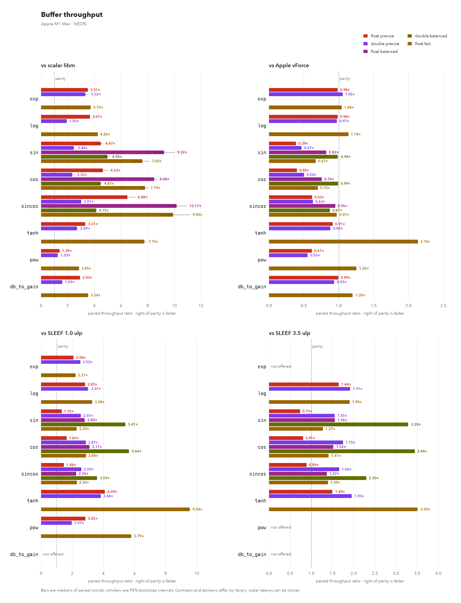
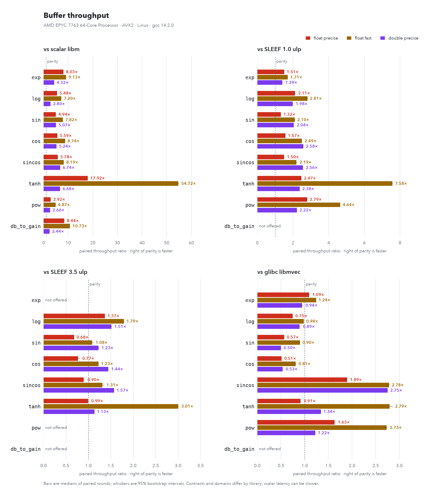
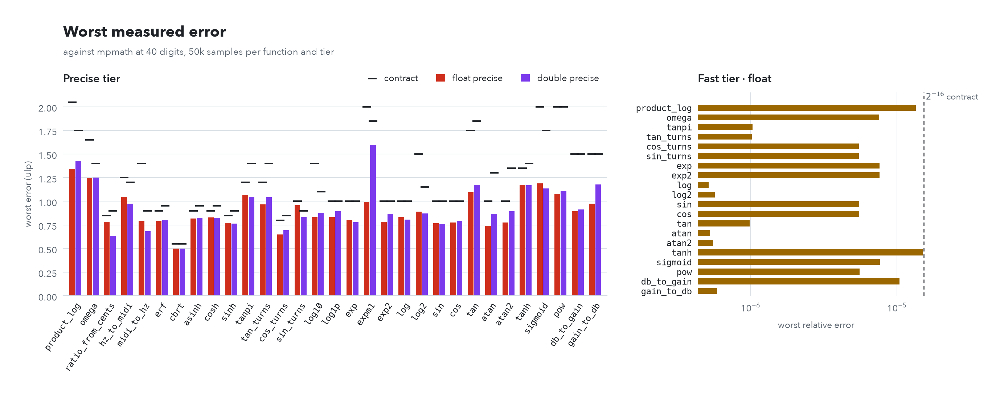
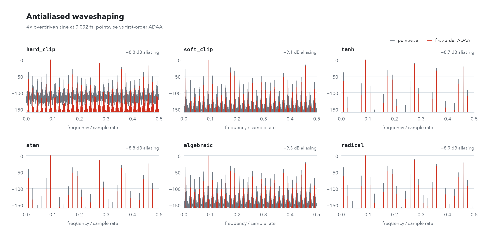
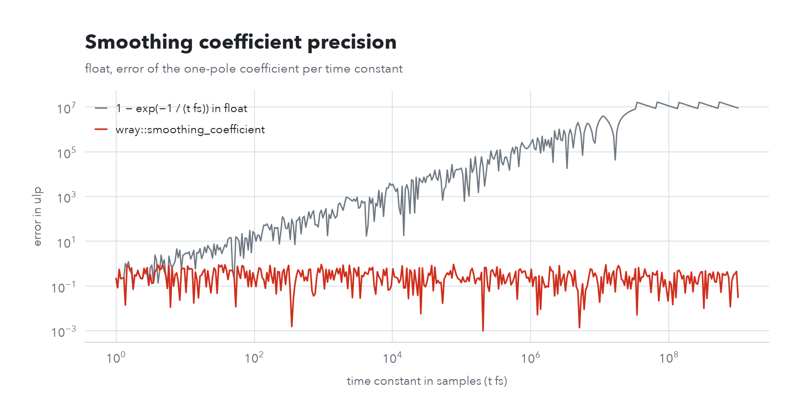
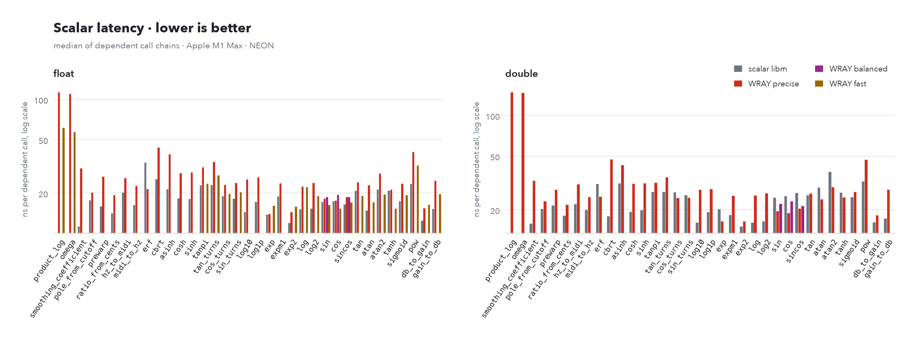
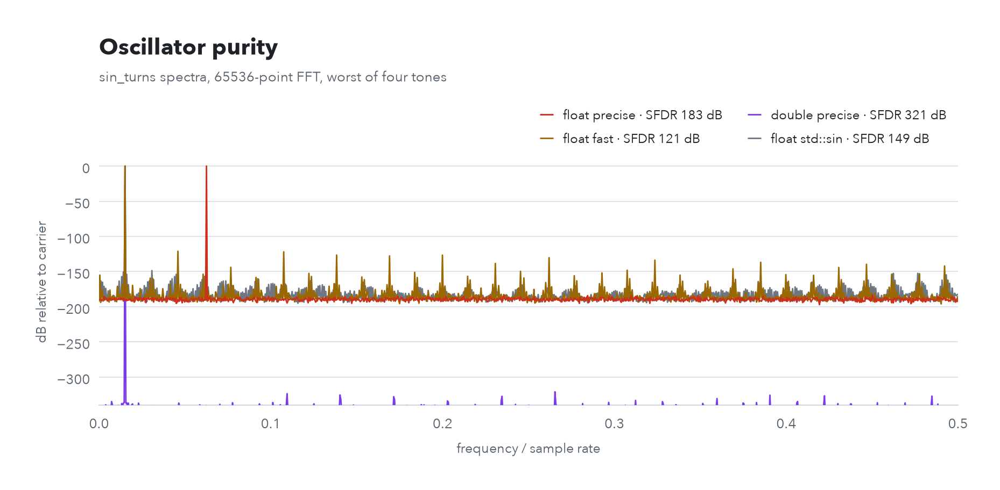
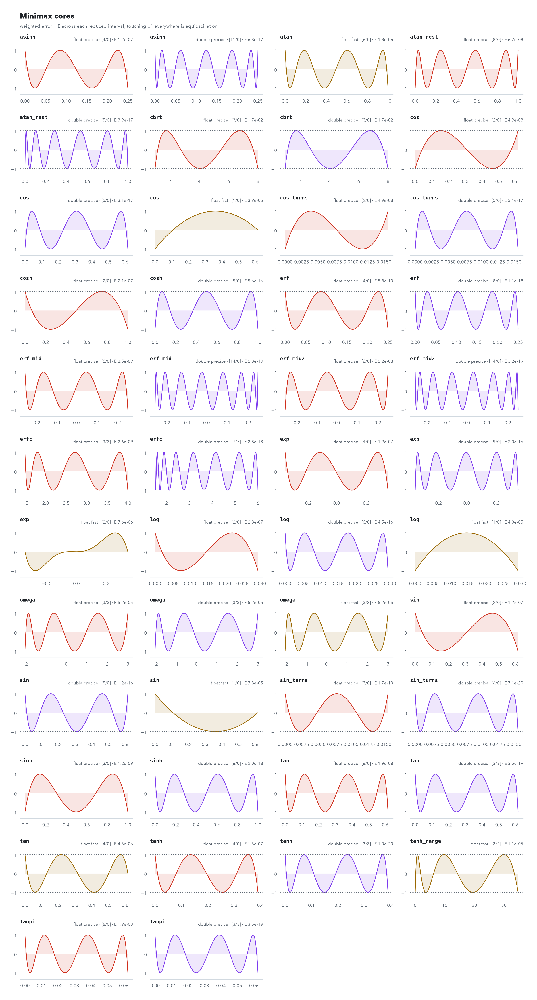
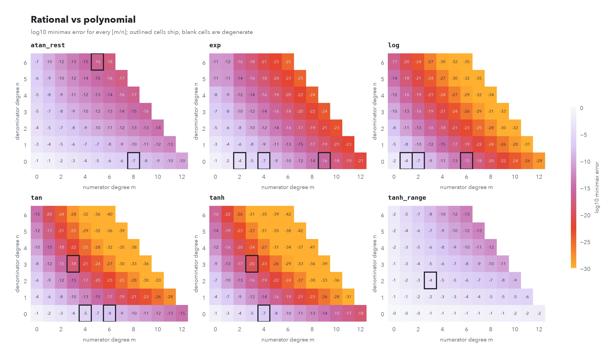

<h1 align="center">
  <picture>
    <source media="(prefers-color-scheme: dark)" srcset="docs/brand/wray-dark.svg">
    
  </picture>
</h1>

<p align="center">
  <a href="https://github.com/Lissajous-Labs/WRAY/actions/workflows/ci.yml"></a>
  <a href="https://github.com/Lissajous-Labs/WRAY/releases/latest"></a>
  <a href="LICENSE"></a>
  
  
</p>

(Wray & Nephew is a high-quality rum; you are highly advised to mix it with juice (JUCE))!

Verified SIMD math for audio DSP: header-only C++20, NEON, SSE2, AVX2, AVX-512 and scalar backends, `float` and `double`.

These kernels are specifically the fast math code in our shipping plugins, Chronos and Torus. Here every core is regenerated from first principles with a rational Remez solver and re-verified against 40-digit arithmetic.

```cpp
#include <wray/wray.h>

float  a = wray::exp(0.5f);
double b = wray::atan2(1.0, -2.0);
auto   v = wray::tanh(wray::f32x4(0.25f));
wray::sin(input, output);
wray::sincos(input, sines, cosines);
double d = wray::balanced::sin(0.5);
auto   p = wray::balanced::sincos(wray::f32x4(0.25f));
float  c = wray::fast::tanh(x);
float  s = wray::sin_turns(phase);
float  k = wray::smoothing_coefficient(0.010f, 48000.0f);
wray::adaa::first_order<wray::adaa::tanh, float> drive;
wray::filters::biquad<wray::f64x2> eq;
```

Every function takes a scalar, a SIMD vector, or a range (any length, no alignment needed, in place allowed):

- elementary: `exp exp2 expm1 log log2 log10 log1p pow cbrt sin cos sincos tan tanpi atan atan2 sinh cosh tanh asinh erf sigmoid`
- turns (one turn is a full cycle): `sin_turns cos_turns sincos_turns tan_turns wrap_turns`
- audio: `db_to_gain gain_to_db midi_to_hz hz_to_midi ratio_from_cents omega product_log`
- parameter maps: `smoothing_coefficient pole_from_cutoff prewarp`

`sincos` and `sincos_turns` write both outputs in one pass, stopping at the shortest range. Their outputs must not overlap; either output can be the input itself.

`wray::balanced::` provides `sin`, `cos`, `sincos`, `tanh` and full-domain `pow` for `float` and `double`, scalar calls, SIMD and ranges. Round-to-nearest bounds are 2.5 ulp for trig and 3 ulp for `tanh`; `pow` has a 4-ulp bound scaled by its exponent product. [Bounds and behavior](docs/details.md#balanced-tier).

`wray::fast::` is a quicker `float`-only tier, accurate to 2^-16 relative error.

**Buffer throughput, not scalar-call latency.** On geometric mean, the precise tier is faster than SLEEF's 1-ulp tier on every platform measured. glibc libmvec (up to 4 ulp) and Apple vForce are faster than it; the fast tier is level with vForce and ahead of libmvec with AVX2 and AVX-512. A dependent scalar call can also be slower than libm. Results apply only to the named machine and backend. [Method and platform results](docs/details.md#performance).

<picture>
  <source media="(prefers-color-scheme: dark)" srcset="docs/charts/speedup-dark.png">
  
</picture>

<picture>
  <source media="(prefers-color-scheme: dark)" srcset="docs/charts/speedup-linux-avx2-dark.png">
  
</picture>

## Use it

Header-only, C++20. Either vendor it:

```cmake
add_subdirectory(WRAY)
target_link_libraries(your_target PRIVATE wray::wray)
```

or install it and use the CMake package:

```sh
cmake -S WRAY -B build -DCMAKE_INSTALL_PREFIX=/your/prefix && cmake --install build
```

```cmake
find_package(wray 1.0 REQUIRED)
target_link_libraries(your_target PRIVATE wray::wray)
```

`WRAY_SIMD` (`auto`, `scalar`, `sse2`, `avx2`, `avx512`) picks the x86 instruction set and travels with the `wray::wray` target.

### From C, Rust, Python or Swift

`wray_c` is a compiled library with a C ABI for languages that cannot use C++ templates. It covers every range function above in `float` and `double`, the balanced tier in both precisions, and the `float` fast tier as buffer calls, with stable unmangled names:

```c
#include <wray/c/wray.h>

wray_sin_f32(in, out, n);
wray_sincos_f64(in, sin_out, cos_out, n);
wray_balanced_sin_f32(in, out, n);
wray_balanced_sincos_f64(in, sin_out, cos_out, n);
wray_balanced_tanh_f64(in, out, n);
wray_pow_f32(x, y, out, n);
wray_balanced_pow_f64(x, y, out, n);
wray_fast_tanh_f32(in, out, n);
```

Configure WRAY with `-DWRAY_BUILD_C_API=ON`, then link `wray::c` or `libwray_c`. Results match the C++ calls bit for bit for the backend the library was built with; `wray_c_backend()` and `wray_c_has_fma()` report it. [Details](docs/details.md#c-api).

## Accuracy contracts

The table below is for the unchanged precise tier: maximum measured error in ulp (units in the last place). Every `float` input is tested for one-argument precise functions; the rest are densely sampled. `pow` loosens for very large results. The balanced trig tier has a separate provisional 2.5-ulp round-to-nearest bound, not a claim of exhaustive verification or measured speed. [Details](docs/details.md#accuracy-contracts).

| function | float | double | function | float | double |
|---|---|---|---|---|---|
| exp | 1.0 | 1.0 | sin | 1.0 | 1.0 |
| exp2 | 1.0 | 1.0 | cos | 1.0 | 1.0 |
| expm1 | 2.0 | 1.85 | tan | 1.75 | 1.85 |
| log | 1.0 | 1.0 | atan | 1.0 | 1.3 |
| log2 | 1.5 | 1.15 | atan2 | 1.0 | 1.35 |
| log10 | 1.4 | 1.1 | sin_turns | 1.0 | 0.9 |
| log1p | 1.0 | 1.0 | cos_turns | 0.8 | 0.85 |
| pow | 2.0 | 2.0 | tanpi | 1.2 | 1.4 |
| cbrt | 0.55 | 0.55 | sinh | 0.85 | 0.9 |
| erf | 0.9 | 0.95 | cosh | 0.9 | 0.95 |
| sigmoid | 2.0 | 1.75 | tanh | 1.35 | 1.4 |
| db_to_gain | 1.5 | 1.5 | asinh | 0.9 | 0.95 |
| gain_to_db | 1.5 | 1.5 | omega | 1.65 | 1.4 |
| midi_to_hz | 1.4 | 0.9 | product_log | 2.05 | 1.75 |
| hz_to_midi | 1.25 | 1.2 | smoothing_coefficient | 2.0 | 2.0 |
| ratio_from_cents | 0.85 | 0.9 | pole_from_cutoff | 2.0 | 2.0 |
| prewarp | 2.0 | 2.0 | tan_turns | 1.2 | 1.4 |

<picture>
  <source media="(prefers-color-scheme: dark)" srcset="docs/charts/accuracy_summary-dark.png">
  
</picture>

## ADAA

`wray::adaa` antialiases six waveshapers (`hard_clip`, `soft_clip`, `tanh`, `atan`, `algebraic`, `radical`) with first-order antiderivatives. It stays accurate for any pair of inputs, including equal ones. For mono buffers, `first_order<Shape, float>::process(in, out)` runs consecutive samples in parallel and matches the per-sample call bit for bit.

| shape | F1 (ulp) | first (ulp) | shape | F1 (ulp) | first (ulp) |
|---|---|---|---|---|---|
| hard_clip | 0.8 | 1.0 | atan | 3.5 | 15.0 |
| soft_clip | 1.5 | 3.0 | algebraic | 6.0 | 62.0 |
| tanh | 3.0 | 10.0 | radical | 3.0 | 5.0 |

<picture>
  <source media="(prefers-color-scheme: dark)" srcset="docs/charts/adaa_aliasing-dark.png">
  
</picture>

## Parameter maps

`smoothing_coefficient`, `pole_from_cutoff` and `prewarp` stay within 2 ulp even at tiny cutoffs where the textbook formulas lose every digit, and return safe values for bad input. [Details](docs/details.md#parameter-maps).

<picture>
  <source media="(prefers-color-scheme: dark)" srcset="docs/charts/smoothing_precision-dark.png">
  
</picture>

## Filters

`wray::filters` has `tpt_one_pole`, `svf` and `biquad`, in any precision or SIMD width. Bad parameters are clamped or ignored, and silence never produces subnormals. For very low cutoffs in `float`, use `svf<float>` or `biquad<float, double>`; for per-sample modulation, use `svf`. [Details](docs/details.md#filters).

## Backends and determinism

NEON, SSE2, AVX2, AVX-512 and scalar backends. Scalar and SIMD code give bit-identical results, except for NaN sign and payload; only builds with and without FMA differ, slightly. [Details](docs/details.md#backends-and-determinism).

<picture>
  <source media="(prefers-color-scheme: dark)" srcset="docs/charts/latency-dark.png">
  
</picture>

The latency chart measures dependent scalar calls, not buffer throughput.

## How it is verified

The established precise and fast tiers are checked on every `float` input, 10^8 `double` inputs per function, 40-digit references, shape and determinism checks, and spectral tests. Balanced trig has a provisional contract; it does not yet inherit those published sweep or timing claims. [Details](docs/details.md#how-it-is-verified).

```sh
cmake -S . -B build -G Ninja && cmake --build build && ctest --test-dir build
```

<picture>
  <source media="(prefers-color-scheme: dark)" srcset="docs/charts/oscillator_sfdr-dark.png">
  
</picture>

## Where it stops working

- x86 without FMA (SSE2, scalar on x86) adds 0.5 ulp to every contract.
- `sin`, `cos` and `tan` slow down for huge arguments but stay accurate. For oscillators, use the turns functions, which stay fast at any phase.
- `exp`, `exp2`, `pow` and `db_to_gain` overflow and underflow where the format runs out.
- The fast tier is `float` only and clamps instead of overflowing.
- Fast-math compiler flags stop the build with `#error`.

Exact thresholds and flag-by-flag behavior: [details](docs/details.md#where-it-stops-working).

## Rational minimax cores

Each core is fitted by a rational Remez exchange; `docs/data/cores.json` records how well each fit converged. [Details](docs/details.md#rational-minimax-cores).

<picture>
  <source media="(prefers-color-scheme: dark)" srcset="docs/charts/remez-dark.png">
  
</picture>

<picture>
  <source media="(prefers-color-scheme: dark)" srcset="docs/charts/pareto-dark.png">
  
</picture>

More charts: per-function accuracy, trig range and full throughput tables are in [docs/details.md](docs/details.md#charts).

## Regenerate

```sh
python3 -m venv .venv && .venv/bin/pip install -r tools/requirements.txt
.venv/bin/python tools/remez/generate.py --header include/wray/math/coefficients.h --report docs/data/cores.json
.venv/bin/python tools/oracle/oracle.py --dump build/tools/wray_dump --out docs/data/accuracy.json --samples 50000 --check
build/bench/wray_bench docs/data/bench.json --baseline vforce
build/tests/wray_spectral_test --json docs/data/spectral.json
.venv/bin/python tools/charts/charts.py --machine "your machine"
.venv/bin/python tools/docs/check_readme.py --dump build/tools/wray_dump
.venv/bin/python tools/brand/logo.py --font path/to/ClashGrotesk-Semibold.ttf
```

`--baseline libm|vforce|sleef_u10|sleef_u35|libmvec` selects the primary denominator; every baseline the build found is recorded side by side. CMake picks up SLEEF 3.9 or newer through `CMAKE_PREFIX_PATH`, and glibc libmvec on Linux x86-64.

## License

GNU General Public License v2.0 or later (GPL-2.0-or-later). See [LICENSE](LICENSE).
