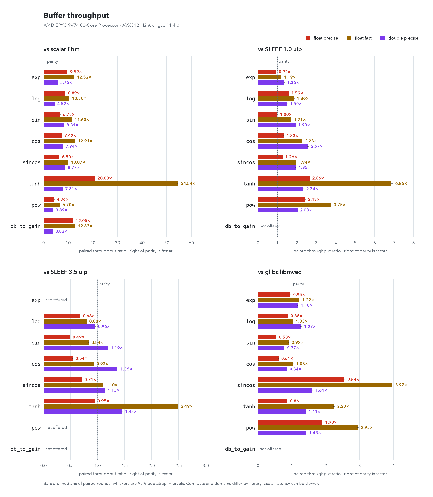
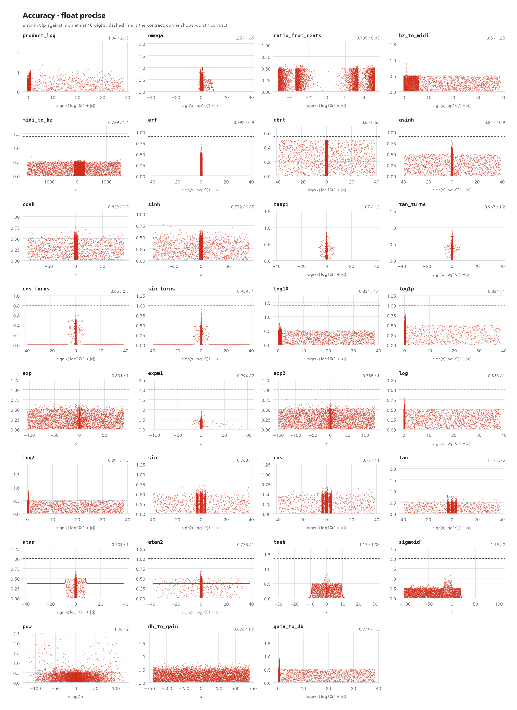
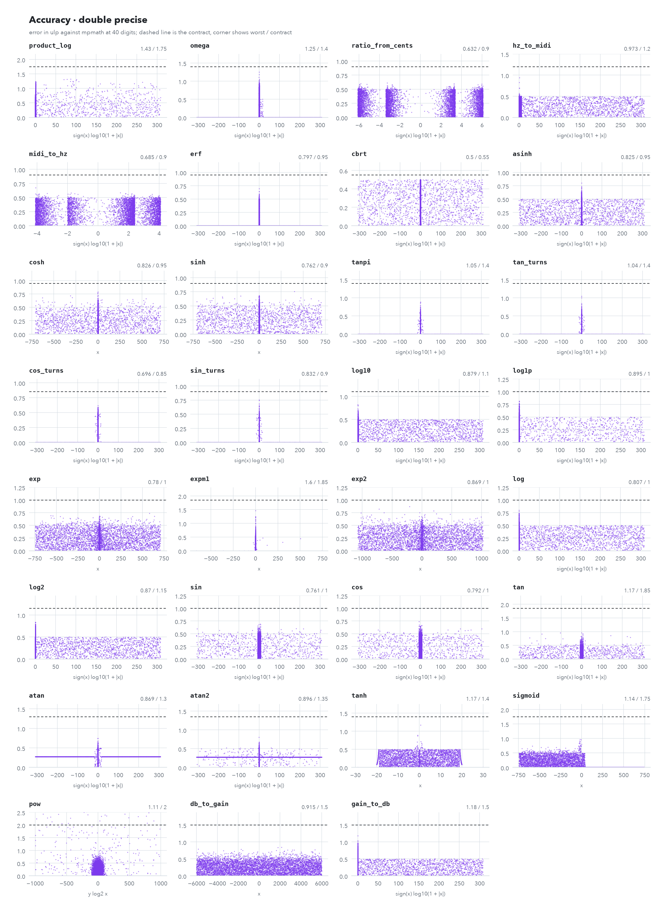
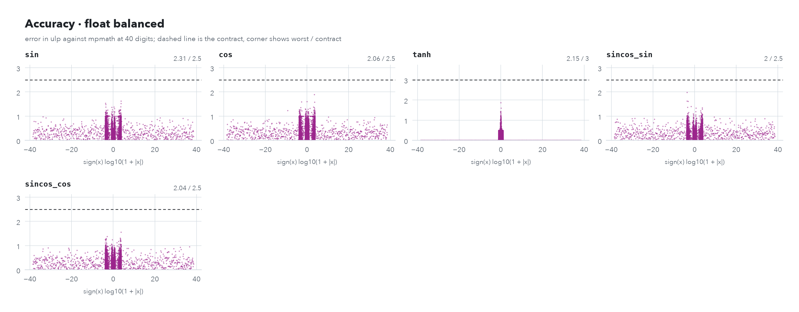
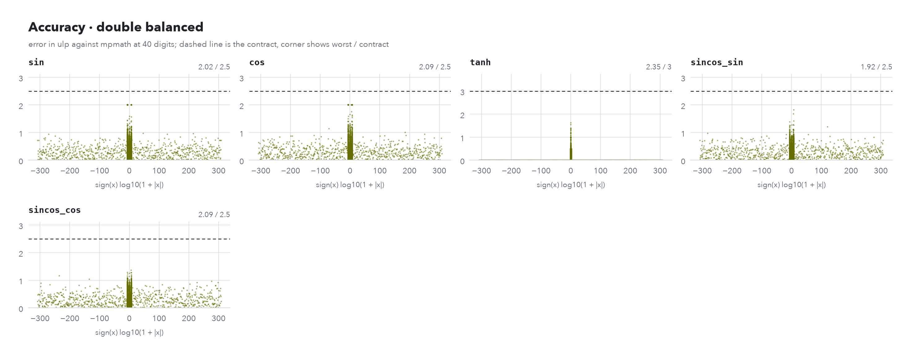
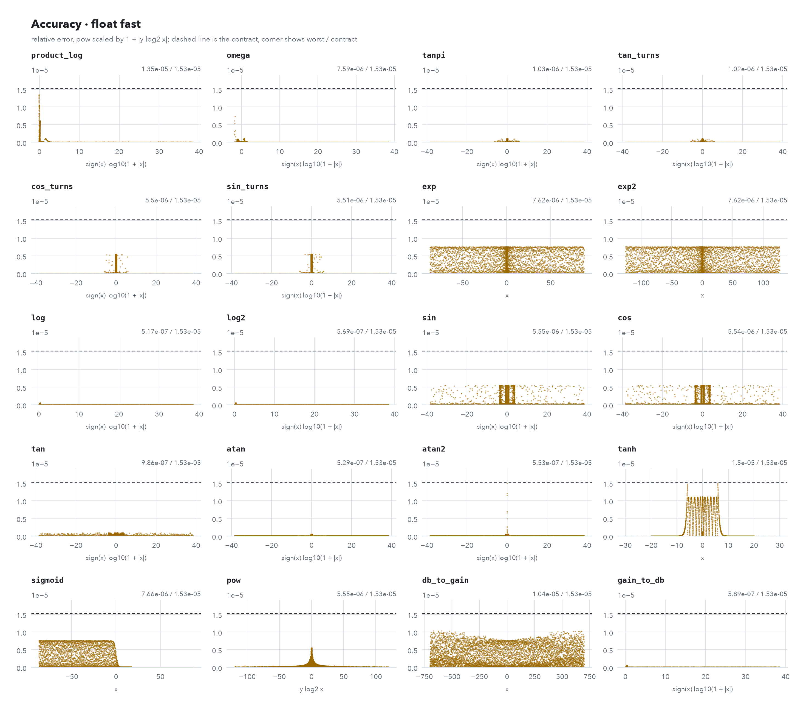
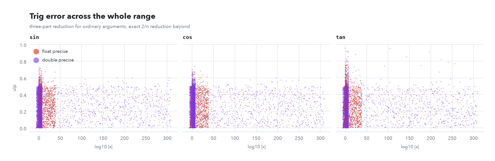
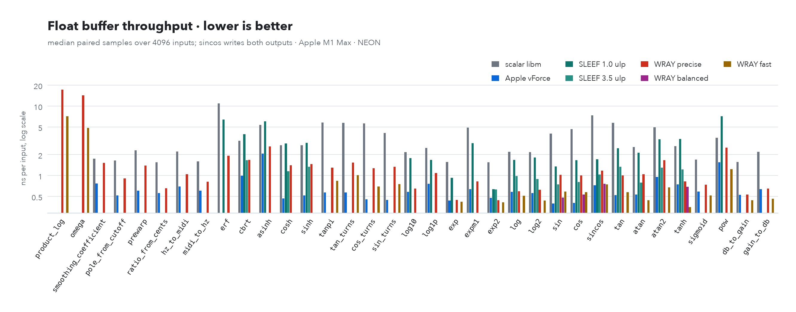
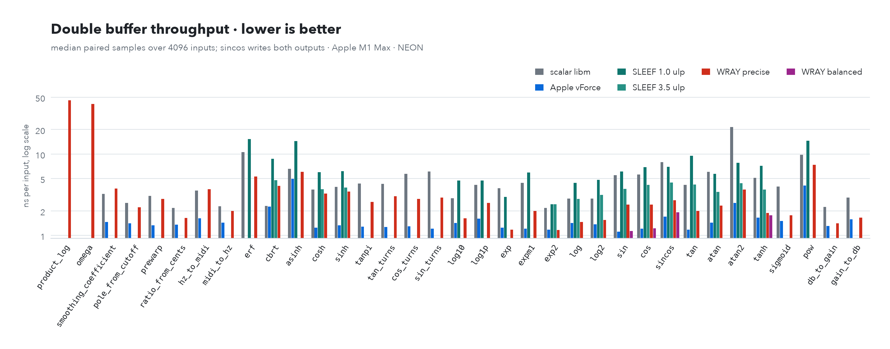

# WRAY details

The full reference behind the [README](../README.md). `tools/docs/check_readme.py` checks the numbers on both pages against the library.

## Accuracy contracts

The contracts are measured bounds, not proofs. Established one-argument `float` functions are checked on every input against a double-precision reference, and every function is sampled against 40-digit mpmath (50,000 points per function and tier in the published data). Established `double` bounds come from 4×10^8 inputs per function against a quad-precision reference in both FMA classes; a weekly run with a new seed checks them again. Balanced trig has separate measurements described below.

`pow` meets its bound while |y·log₂|x|| ≤ 4; past that the bound scales with the product, to contract × |y·log₂|x|| / 4 ulp, because the error of log₂|x| is multiplied by y. Negative bases follow C: integer exponents give the signed power and other exponents give NaN. The fast tier's 2^-16 bound for `pow` is likewise relative to 1 + |y·log₂|x||.

Beyond the error bound, the precise tier keeps shape: every function is checked for monotonicity on its monotone intervals, exact odd or even symmetry, range bounds, and finite outputs for finite inputs, over every `float` and a dense `double` sample. The few documented exceptions are listed in `tests/accuracy_test.cpp`. `midi_to_hz(69 + 12k)` is exactly `440 * 2^k`, and at multiples of 1/8 turn the turns functions return the correctly rounded value.

## Balanced tier

Use `wray::balanced::sin`, `wray::balanced::cos`, `wray::balanced::sincos` or `wray::balanced::tanh` when the precise tier's tighter error bounds are unnecessary. All four accept `float`, `double`, SIMD vectors and ranges, like their precise counterparts. Selecting this namespace is explicit; existing `wray::` and `wray::fast::` calls retain their behavior and contracts.

The bounds below apply in round-to-nearest with FMA. Add 0.5 ulp without FMA. Directed-rounding modes use an 8-ulp bound, plus the same no-FMA margin; uncompensated evaluation is more sensitive to rounding direction than the precise tier.

| function | float | double |
|---|---|---|
| sin | 2.5 | 2.5 |
| cos | 2.5 | 2.5 |
| sincos | 2.5 | 2.5 |
| tanh | 3.0 | 3.0 |

- Each `sincos` output has its own bound against the corresponding exact sine or cosine. Scalar and SIMD `sincos` return an object with `.sin` and `.cos` members.
- Paired `sincos` uses a different reduction and approximation from separate balanced `sin` and `cos` calls. Its outputs need not be bit-identical to those separate calls; the same accuracy bound applies to both forms.
- Every finite input is supported, including the largest finite `float` and `double`. Huge trig arguments take a slower exact reduction rather than a clamped or missing result.
- Trig infinity and NaN inputs return NaN in both separate and paired outputs. Sine preserves signed zero; cosine of either zero is exactly 1.
- Balanced `tanh` preserves signed zero, returns NaN for NaN, and returns signed 1 for infinities. It shares precise `tanh`'s saturation clamp and returns signed 1 at and beyond that magnitude. Its bounds are 3 ulp in round-to-nearest and 8 ulp in directed rounding, each plus 0.5 ulp without FMA.
- The `tanh` core reconstructs `e = expm1(2*abs(x))` with FMA from the existing precise exponential cores. It uses `e/(e+2)` near zero to avoid cancellation and `1-2/(e+2)` above that region to avoid rounding-induced dips near saturation.
- For the same function, input and FMA class, scalar and SIMD results are bit-identical apart from NaN sign and payload, including vectors mixing ordinary and huge arguments.
- Range calls stop at the shortest input/output range, accept any length and alignment, and support exact in-place input/output aliasing. For `sincos(in, sin_out, cos_out)`, the output ranges must not overlap; either output may exactly alias the input. Partial overlap is not supported.
- The C buffer entry points are `wray_balanced_sin_f32`, `wray_balanced_cos_f32`, `wray_balanced_sincos_f32`, `wray_balanced_tanh_f32` and the corresponding `_f64` names. Their argument layouts and aliasing rules are the same as the [C API](#c-api).

Balanced trig has been checked over every finite `float` input on NEON and non-FMA SSE2 against double-precision libm: the worst error across all four outputs was 2.454 ulp, with no non-finite outputs. Separate and paired `double` outputs were checked on 160,000 inputs against 60-digit mpmath, including root neighborhoods, tiny values and huge arguments; the worst observed error was 2.270 ulp. The ordinary path uses four split π terms; separate calls use a half-period sine core, while paired calls retain quarter-period sine and cosine cores. Oracle checks additionally cover both FMA classes.

Balanced `tanh` passed every finite `float` input on NEON (worst 2.457 ulp) and non-FMA SSE2 (2.533 ulp), with finite outputs inside [-1, 1]. High-precision sampling covered 200,000 inputs per type and FMA class. On M1 Max NEON, its paired buffer throughput measured 1.084× vForce for float and 0.937× for double; scalar-call latency remained slower than WRAY precise.

## Parameter maps

`smoothing_coefficient`, `pole_from_cutoff` and `prewarp` stay within 2 ulp for every time constant and cutoff down to 1e-9 of the sample rate. Outside their domain they return safe values:

| input | `smoothing_coefficient` | `pole_from_cutoff` | `prewarp` |
|---|---|---|---|
| time constant or cutoff ≤ 0 | 1 | 1 | 0 |
| sample rate ≤ 0 | 1 | 0 | largest value |
| cutoff ≥ Nyquist | | | ratio just below 0.5: 1.07e7 (float), 5.73e15 (double) |
| NaN | NaN | NaN | NaN |

No input gives a pole above 1 or a coefficient outside [0, 1].

## Filters

`tpt_one_pole`, `svf` and `biquad` cover lowpass, highpass, bandpass, notch, peak, shelves, allpass, and tilt for the SVF. They are designed with half-angle formulas in double and run in `float`, `double` or any SIMD width.

- Parameters are clamped: cutoff to [1e-6, 0.4999] of the sample rate, Q to [1e-3, 1e3], gain to ±120 dB. A non-finite or non-positive sample rate falls back to 48 kHz.
- A NaN cutoff, Q or gain keeps that parameter's previous value. A new filter starts at 1 kHz, Q 0.7071 and 0 dB.
- With 0 dB gain, inputs up to an eighth of the format's maximum keep every filter's state and output finite.
- Coefficients are kept strictly stable in the processing precision. State is flushed to exact zero below 2^-80 (float) or 2^-200 (double), so silence never produces subnormals.
- Filters recover from NaN input after `reset()`.

`biquad<float>` rounds its coefficients to float, which moves the poles of very low cutoffs: it holds DC and cutoff gain within 0.5% only for cutoffs of at least fs/1000, and at 768 kHz a 20 Hz lowpass has a DC gain of 0.22. For lower cutoffs use `biquad<float, double>`, which keeps double coefficients and state for float audio, or `svf<float>`; both stay within 1e-5 down to 1e-6 of the sample rate.

A deep sweep checks 4000 random parameter sets per filter type and precision, plus edge parameters, from 8 kHz to 768 kHz against the exact bilinear prototype, scaled by the condition of each response. With cutoff, Q and gain on a random walk across their whole ranges and changed every sample, `svf` stays below 1e8 and `tpt_one_pole` below 4 for inputs within ±1. `biquad` is a direct form: stable for fixed coefficients and slow changes, but per-sample modulation can make it grow without bound, so modulate an `svf` instead.

## Backends and determinism

- NEON covers arm64 with GCC, Clang and MSVC (Windows on ARM).
- The headers compile without warnings under `-Wall -Wextra -Wpedantic -Wconversion -Wsign-conversion -Wdouble-promotion -Wold-style-cast -Wshadow` and MSVC `/W4`.
- Scalar and SIMD results are bit-identical apart from the sign and payload of NaN results.
- Results depend only on whether the build has FMA. Golden digests in `tests/golden` pin every function's output for the FMA class (NEON, AVX2, AVX-512) and the no-FMA class (SSE2, and scalar on x86), across compilers.
- `WRAY_STRICT_FP` (on by default) stops consumers' compilers from contracting the library's arithmetic.
- Every header lives in an inline namespace named after its backend and FMA class (for example `wray::abi_avx2_fma`), so translation units compiled with different SIMD flags can share one program without the linker merging their code.

## C API

`include/wray/c/wray.h` declares a C99 interface, built as `wray_c` (static, or shared with `-DBUILD_SHARED_LIBS=ON`) and exported as `wray::c`. Build it with `-DWRAY_BUILD_C_API=ON`; it is off by default, so installing the headers needs no compiled library.

- Every precise function is `void wray_<name>_<f32|f64>(...)`, with `wray_fast_<name>_f32` for the fast tier and `wray_balanced_<sin|cos|sincos|tanh>_<f32|f64>` for the balanced tier. One-input functions take `(const T *in, T *out, size_t n)`; `sincos` and `sincos_turns` take `(const T *in, T *sin_out, T *cos_out, size_t n)`; two-input functions keep the C++ argument order, such as `wray_atan2_f64(y, x, out, n)` and `wray_pow_f32(x, y, out, n)`.
- Exactly `n` elements are read and written. An output may be the same buffer as an input; partially overlapping buffers are not supported. With `n == 0` nothing is touched.
- Results are those of the matching C++ range function, bit for bit, for the backend and FMA class the library was compiled with. `wray_c_backend()` returns `"neon"`, `"sse2"`, `"avx2"`, `"avx512"` or `"scalar"`, and `wray_c_has_fma()` returns 1 or 0. Build `wray_c` with the most capable `WRAY_SIMD` your deployment targets support; one binary does not switch backends at run time.
- No C++ symbols are exported, and no structs or callbacks cross the boundary, so Rust (`extern "C"`), Python (`ctypes` or `cffi`), Swift (a module map over the header), C# (`DllImport`) and LuaJIT FFI bind it directly.
- `WRAY_C_ABI_VERSION` and `wray_c_abi_version()` start at 1. Existing names and signatures stay unchanged within a major version; new functions only add symbols.

## Performance

The speed charts measure **buffer throughput**, not scalar latency. A speedup above 1× means WRAY is faster than the named baseline; below 1× means it is slower. Do not transfer a ratio between platforms, processors or backends.

On Apple, vForce is the primary baseline, with explicitly scalar libm shown alongside it. Precise `sincos` is slower than vForce on the M1 Max. WRAY instead offers its published error contracts and bit-reproducible results within one version and FMA class. Apple's `vForce.h` says exact results and subnormal handling may vary across microarchitectures and OS versions; it also permits subnormals to flush to zero. This is a reproducibility distinction, not evidence that vForce is inaccurate. [Apple vForce documentation](https://developer.apple.com/documentation/accelerate/vforce-library).

Linux x86 runs also measure SLEEF 3.9 at its 1.0-ulp and 3.5-ulp tiers and glibc libmvec, which glibc documents as accurate to 4 ulp, each at the backend's native vector width. SLEEF is called through its ISA-specific entry points (`sse2`, `avx2`, `avx512f`, `advsimd`), not its runtime dispatcher. libmvec is called through the x86 vector function ABI symbols that GCC emits: its SSE entry points can run SSE4.1 code on hosts that have it, while WRAY's SSE2 build does not, and its `sincos` takes vectors of output pointers. Before timing, every vector baseline's outputs are checked against scalar libm on the same inputs, so a mismatched binding stops the run. macOS measures SLEEF when CMake can find it, for example after `brew install sleef`. Windows runs keep scalar libm as their only baseline. Apple ratios do not predict x86 performance.

Measured standings, as geometric means over the functions each library provides:

- Against SLEEF's 1.0-ulp tier, the precise tier is faster on 16–20 of 20 shared functions: 1.6–1.9× on Linux x86 (SSE2, AVX2, AVX-512) and 2.2–2.6× on the M1 Max.
- Against libmvec and vForce it is slower: 0.69–0.84× libmvec with AVX2 and AVX-512, 0.43–0.50× with SSE2, and 0.6× vForce. Against SLEEF's 3.5-ulp tier it ranges from 0.6× (Linux SSE2, float) to 1.6× (M1 Max, double).
- The fast tier, at a 2⁻¹⁶ relative-error contract, is 1.34–1.46× libmvec with AVX2 and AVX-512 and 0.9× with SSE2, 1.0–1.8× SLEEF's 3.5-ulp tier, and level with vForce.

These libraries promise different accuracy: the precise tier holds the per-function bounds in the [accuracy table](../README.md#accuracy-contracts), and none of the others document bit-identical results across their own backends.

`wray_bench [output.json] --baseline libm|vforce|sleef_u10|sleef_u35|libmvec [function ...]` selects the primary throughput denominator, and every baseline the build found is measured. `libm.cpp` is compiled with Clang's `-fno-vectorize -fno-slp-vectorize`, GCC's `-fno-tree-vectorize`, or MSVC's `/Qvec-`: ordinary scalar optimization and fused scalar sine/cosine calls remain enabled. vForce uses its native array routines; compound audio functions include their input/output transforms. Smoothing uses the stable `-expm1(-1/(seconds*fs))` formula, and the gain baseline uses base-2 exponentiation rather than a general power.

Each math comparison uses 4096 inputs, 40 repetitions per sample and 25 paired rounds, alternating ABBA and BAAB order. Speedups are medians of paired ratios, with 95% bootstrap intervals from 5000 resamples. A WRAY-vs-itself comparison records the timing noise. JSON retains every timing and ratio sample, the chosen denominator per row, CPU, OS, compiler, flags, backend and source revision when supplied through `WRAY_BENCH_REVISION` or GitHub Actions. `none` means there is no selected baseline for that row—not a hidden fallback. vForce has no `erf`, `omega` or `product_log` counterpart in this harness.

`sincos` throughput computes and writes both outputs through the public fused range overload. Latency instead measures dependent scalar calls against scalar libm, including the chain scaffolding; vForce is a bulk API, not a scalar latency baseline. Precise kernels can lose to libm here because compensated arithmetic lengthens the dependency chain. The data also includes edge-input throughput, filter blocks, coefficient updates and each ADAA shape against its pointwise version.

Balanced `sin`, `cos` and `sincos` have float and double throughput, edge-input throughput and dependent scalar latency rows under the variant name `wray balanced`. They use the same inputs, paired rounds, available competitors and output consumption as the other tiers. On M1 Max NEON, the published paired run measured 0.76–0.95× vForce throughput in float and 0.87–0.99× in double: substantially faster than WRAY precise, but not a win over vForce. Separate-call scalar latency regressed relative to WRAY precise. Charts omit unavailable balanced functions rather than substituting precise or fast results.

Balanced `tanh` uses the same `wray balanced` throughput, edge-input and dependent scalar latency harness in float and double. No measured throughput or latency claim is made here for balanced `tanh`.

For native x86 measurements, run `python tools/ci/benchmark.py --out benchmark-results` or dispatch CI with `benchmarks=true`. Each host runs its supported backends sequentially, never under an instruction emulator. CI collects Linux and Windows hosts and requires native results for SSE2, AVX2 and AVX-512 across the collected artifacts. Hosted-VM timings are not bare-metal measurements; CPU, compiler, flags and host manifests stay with the data.

## How it is verified

Pull requests run CI. `main` only advances by fast-forwarding to a pull request head whose `ci-pass` succeeded, so every commit on `main` has already passed the full matrix and keeps its signature; pushes do not run the matrix again. Manual and scheduled runs have separate concurrency groups, so ordinary development cannot cancel a release sweep.

Documentation-only pull requests run the README checks instead of the full matrix. A failed change comparison blocks CI rather than skipping the code checks.

Balanced functions use separate `balanced_f32` and `balanced_f64` accuracy and determinism tiers. The exhaustive finite-float and sampled high-precision double measurements for balanced trig are described in [Balanced tier](#balanced-tier); they do not describe balanced `tanh`. The older quad-precision sweep counts below are not claims about this new tier.

- Exhaustive: every `float` input (all 2^32 bit patterns) for each unary function, `wray_accuracy_test --exhaustive`, weekly on NEON, SSE2, AVX2, AVX-512 and the scalar backend; the same run repeats every fourth input under flush-to-zero and each rounding mode, after reading back that the mode took effect.
- Double: 10^8 inputs per `double` function weekly against a quad-precision reference (`tools/dense`, GCC on x86-64), with a rotating seed and the contracts as the gate; the reference is itself checked against mpmath on every run.
- Dense: every function and tier against mpmath at 40 digits, `tools/oracle/oracle.py --check`.
- Shape: monotonicity, symmetry, bounds and finiteness, exhaustive in `float` and sampled in `double`.
- Host: every function again under flush-to-zero and in all four rounding modes, after reading back that each mode took effect.
- Determinism: golden output digests per FMA class, covering every function, `sincos`, `wrap_turns`, every filter type with a parameter change mid-stream, and the stateful ADAA processors, and bit-identical scalar and SIMD results on every backend apart from NaN sign and payload.
- Spectral: oscillator SFDR, ADAA aliasing and parameter-map precision each assert a recorded limit (`wray_spectral_test`).
- Headers: every public header compiles on its own, twice in one translation unit, under every CI compiler and backend.

## Where it stops working

### Hardware and rounding

- x86 builds without FMA (SSE2, and the scalar backend on x86) add 0.5 ulp to every precise and balanced contract; arm64 always has FMA, scalar backend included.
- For the established precise and fast tiers, flush-to-zero measurements stay within contract for normal inputs and outputs; subnormals read and write as zero.
- For those established tiers, directed-rounding measurements grow by at most 1 ulp. Balanced functions have a separate 8-ulp directed-rounding bound, with the no-FMA margin above; the `tanh` bound is a candidate.

### Large trig arguments

The precise and fast `sin`, `cos`, `sincos` and `tan` use a fast three-part reduction up to:

| | float | double |
|---|---|---|
| fast reduction for \|x\| ≤ | 6433.98 (2048π) | 6588397.3 (2^22·π/2) |

Larger finite inputs take a slower exact reduction against a 1280-bit table of 2/π, lane by lane. Every finite input still gets an accurate result; only infinities and NaN return NaN. The fast tier uses the same reductions and stays within 2^-16 for every finite input. Balanced trig also supports the full finite domain with exact reduction for huge inputs, under its separate [contract](#balanced-tier).

The turns functions reduce exactly at any magnitude: whole turns are removed without rounding, so the result carries only the polynomial's error. For example, in double, `sin_turns(2^40 + 0.25)` is exactly 1; that input is not representable in float. For oscillators and phase accumulators, keep the phase in turns and use `sin_turns`, `cos_turns` and `sincos_turns`, so a growing phase never reaches the slow path.

### Overflow and underflow

| function | finite up to | infinite from | nonzero down to | 0 from |
|---|---|---|---|---|
| `exp` float | 88.72 | 88.73 | -103.97 | -103.98 |
| `exp` double | 709.78 | 709.79 | -745.13 | -745.14 |
| `exp2` float | just below 128 | 128 | just above -150 | -150 |
| `exp2` double | just below 1024 | 1024 | just above -1075 | -1075 |
| `db_to_gain` float (dB) | 770.63 | 770.64 | -903.08 | -903.09 |
| `db_to_gain` double (dB) | 6165.09 | 6165.10 | -6472.14 | -6472.15 |

`pow` overflows when y·log₂|x| reaches 128 (float) or 1024 (double).

### Fast tier

The fast tier exists for `float` only.

- Clamped, so they never return infinities, zeros from underflow, or subnormals: `exp` clamps its argument to [-87, 88]; `exp2`, `pow` and `db_to_gain` clamp the base-2 exponent to [-126, 127].
- `tanh` is exactly ±1 from 5.9.
- Not clamped: fast `log` of 0 returns -88.03 rather than -infinity, and fast `sigmoid` can return subnormals for large negative inputs.
- NaN input gives NaN. `sin`, `cos` and `tan` of infinity give NaN.
- `log`, `log2` and `gain_to_db` return NaN below zero, treat -0 as 0, and read +infinity as 2^128 (`log` gives 88.72).
- `pow` returns NaN when either argument is NaN, including `pow(x, 0)`, and for a negative base with a non-integer exponent. It reads 0 as 2^-127 and infinity as 2^128 before clamping, so `pow(0, 2)` is the smallest normal float rather than 0.

### Compiler flags

Fast floating-point models break the compensated arithmetic.

| flag | outcome |
|---|---|
| `-ffast-math`, clang `-ffp-model=fast` (`__FAST_MATH__`), MSVC `/fp:fast` (`_M_FP_FAST`) | `#error` |
| `-ffinite-math-only` | `#error` |
| GCC `-fassociative-math`, `-freciprocal-math`, `-fno-signed-zeros` | `#error` |
| `FLT_EVAL_METHOD` other than 0 (x87 on 32-bit x86) | `#error` |
| clang `-fassociative-math`, `-freciprocal-math`, `-fno-signed-zeros`, `-fapprox-func`, default contraction | no effect on wray's results |
| MSVC `/fp:contract` | no effect on wray's results |
| clang `-ffp-contract=fast`, GCC contraction | changes results; `wray::floating_point_ok()` reports it |
| clang `-fno-honor-nans`, `-fno-honor-infinities` | unsupported |

- On clang the headers wrap their own code in `#pragma float_control(precise, on)` and `#pragma clang fp contract(off) reassociate(off)` and do their vector arithmetic with operators inside that region; MSVC contraction is switched off the same way. Clang ignores the contraction pragma under `-ffp-contract=fast`, and GCC has no such pragma for C++.
- Linking `wray::wray` adds `-ffp-contract=off`.
- `wray::floating_point_ok()` checks rounding of sums and products, no reassociation, exact division, no contraction, NaN, infinity and signed zeros, run in wray's floating-point model.
- `-fno-honor-nans` and `-fno-honor-infinities` make every NaN or infinity in the caller's own code undefined.
- `tools/ci/hostile_flags.sh` checks each outcome, and `tools/ci/header_only.sh` checks consumers that include the headers without the CMake target.
- Define `WRAY_ALLOW_FAST_MATH` to build anyway, at your own risk.

## Rational minimax cores

Each core is fitted by a rational Remez exchange on its reduced interval. `docs/data/cores.json` records, per core, whether the exchange levelled the weighted error to within 1e-9 of equioscillation; a fit that did not converge is kept as the best candidate found and marked `"converged": false`. Rational or polynomial is chosen per core by cost at the target accuracy.

## Charts

Every chart comes in a dark and a light variant, regenerated by `tools/charts/charts.py` from `docs/data`.

Balanced measurements appear in the throughput and accuracy figures. The paired components are named `sincos_sin` and `sincos_cos` in the accuracy data.

<picture>
  <source media="(prefers-color-scheme: dark)" srcset="charts/speedup-linux-avx512-dark.png">
  
</picture>

<picture>
  <source media="(prefers-color-scheme: dark)" srcset="charts/accuracy_f32-dark.png">
  
</picture>

<picture>
  <source media="(prefers-color-scheme: dark)" srcset="charts/accuracy_f64-dark.png">
  
</picture>

<picture>
  <source media="(prefers-color-scheme: dark)" srcset="charts/accuracy_balanced_f32-dark.png">
  
</picture>

<picture>
  <source media="(prefers-color-scheme: dark)" srcset="charts/accuracy_balanced_f64-dark.png">
  
</picture>

<picture>
  <source media="(prefers-color-scheme: dark)" srcset="charts/accuracy_fast-dark.png">
  
</picture>

<picture>
  <source media="(prefers-color-scheme: dark)" srcset="charts/trig_range-dark.png">
  
</picture>

<picture>
  <source media="(prefers-color-scheme: dark)" srcset="charts/throughput_f32-dark.png">
  
</picture>

<picture>
  <source media="(prefers-color-scheme: dark)" srcset="charts/throughput_f64-dark.png">
  
</picture>

## Stability

WRAY uses semantic versioning, read as follows.

| change | version |
|---|---|
| removing or renaming a public function, type or header, or changing what a call computes | major |
| raising (loosening) any accuracy contract in the README tables | major |
| dropping a backend, compiler or C++ standard that a release supported | major |
| new functions, shapes, filters, backends or tiers; lowering (tightening) a contract | minor |
| bug fixes, speedups and documentation, including output changes within the contracts | patch |

- Golden digests in `tests/golden` pin output bits for one version and FMA class. They are not covered by this policy: a patch may change them as long as every contract still holds.
- The inline ABI namespace (`wray::abi_avx2_fma` and the like) is not stable. Code that names it directly may break in any release, and every translation unit in one program must use the same WRAY version.
- The C API in `include/wray/c/wray.h` is stable: renaming or removing a function, or changing a signature, is a major change, and `WRAY_C_ABI_VERSION` changes with it.
- `find_package(wray X.Y)` accepts any later release with the same major version.
